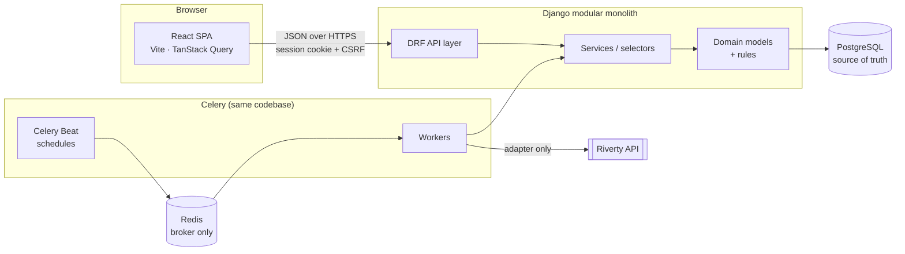
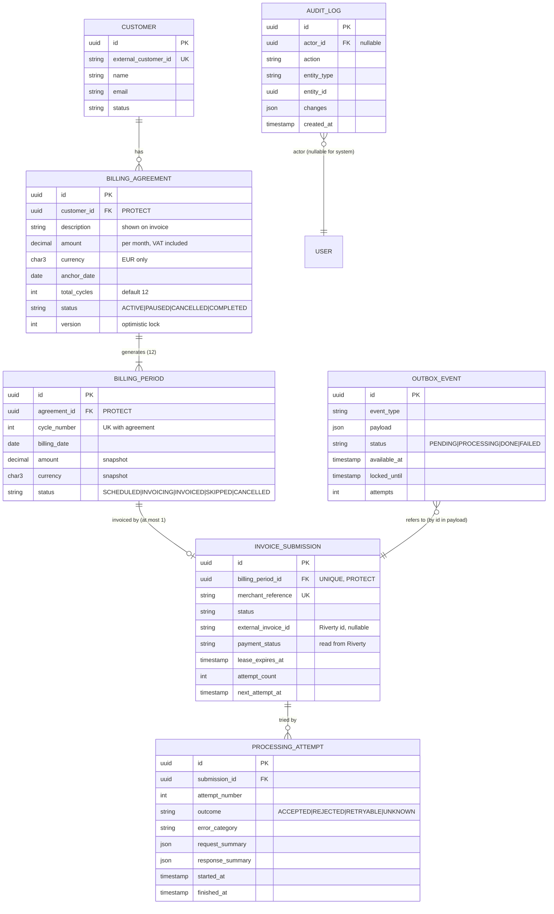
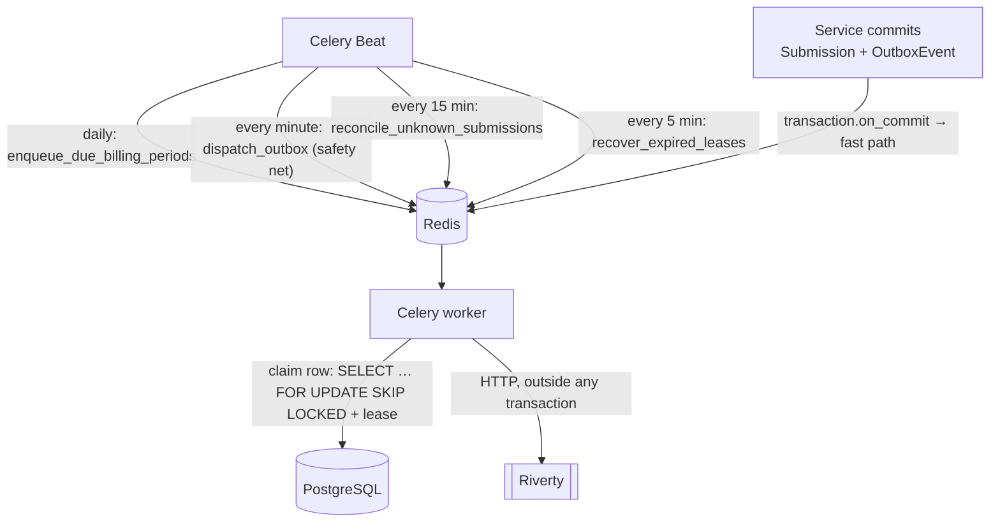
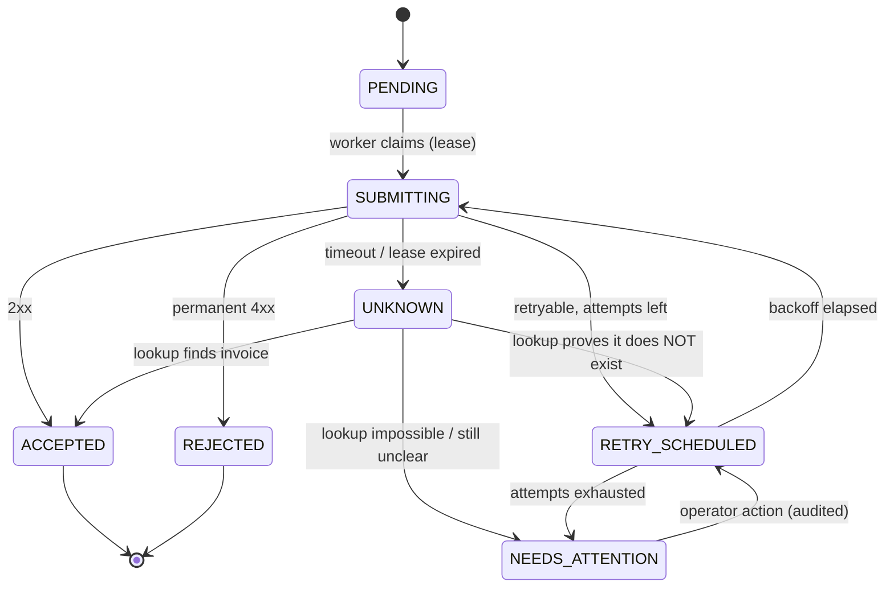

# Architecture — Recurring Invoice Automation Platform

> Status: target architecture. Phase 1 (foundation) is implemented; later sections describe
> what each phase builds. Riverty-specific details are **unverified** until Phase 6 (see §A.5).

## Scope boundary

| Our system (billing orchestration) | Riverty (delivery and money) |
|---|---|
| Customers, agreements, monthly schedules | Invoice delivery to the customer |
| Generating billing obligations (periods) | Payment processing |
| Submitting invoices, preventing duplicates | Reminders, dunning, collections |
| Retry, reconciliation, audit, dashboards | Payment status (we only *read* it) |

We never move money. "Invoice accepted by Riverty" ≠ "invoice paid".

---

## Part A — Final architecture

### A.1 Shape: a modular monolith

One Django deployable, one PostgreSQL database, plus Celery workers that run **the same
codebase**. Inside it, code is split into apps with explicit boundaries.

**Why not microservices?** 100–300 invoices/month is tiny load. Microservices would turn
every cross-module call into a network call that can fail, and would replace simple local
transactions with distributed ones. The hardest problem we have (exactly one invoice per
billing period) is *easiest* when the period, the submission and the outbox event can be
written in **one database transaction**. A monolith gives us that for free.
Modules can still be extracted later if a real reason appears; clean app boundaries keep
that option open.



### A.2 Backend layers

| Layer | Lives in | Responsibility | Must NOT |
|---|---|---|---|
| Presentation | `views.py`, `serializers.py`, `permissions.py`, `urls.py` | HTTP, auth, input shape validation, output formatting | Contain business rules or open transactions |
| Application | `services.py` (writes), `selectors.py` (reads) | One function per use case; owns `transaction.atomic()` boundaries; writes audit logs and outbox events | Know about HTTP request objects |
| Domain | `models.py`, `domain/` modules (state machines, date maths) | Entities, invariants, state transitions, billing calculations | Call external APIs |
| Background | `tasks.py` | Thin Celery entry points that call services | Hold business logic themselves |
| Integration | `apps/integrations/riverty/` | Riverty HTTP client, auth, request/response mapping, error classification | Leak Riverty types outside the adapter |
| Persistence | Django ORM + PostgreSQL | Constraints, indexes, transactions, row locks | n/a |
| Operations | `apps/operations/` | Audit log, processing attempts, outbox, health, job views | n/a |

The dependency rule is **downwards only**: views → services → domain/models. Tasks are
just another "view" (an entry point) that calls services. This is why the same
`submit_invoice()` service can be triggered by Celery *or* by an operator clicking
"Retry" in the dashboard, with identical behaviour.

**Services vs selectors.** A service changes state (`pause_agreement(agreement, by_user)`);
a selector only reads (`list_due_billing_periods(on_date)`). Splitting them keeps
query optimisation (`select_related`, annotations) in one place and makes it obvious
which functions need transactions.

### A.3 Django apps and boundaries

```
backend/
  config/                 settings (base/local/test/production), urls, wsgi/asgi, celery (Ph.7)
  apps/
    core/                 base models, error envelope, pagination, health check   [Ph.1]
    accounts/             staff User (email login), session auth endpoints         [Ph.1]
    customers/            Customer: who we bill                                     [Ph.2]
    agreements/           BillingAgreement + lifecycle (active/paused/cancelled)   [Ph.3]
    billing/              BillingPeriod generation, date maths, snapshots          [Ph.4]
    invoicing/            InvoiceSubmission + ProcessingAttempt, state machine,    [Ph.5]
                          gateway interface + fake, billing-cycle command
    integrations/riverty/ Riverty adapter (client, mapping, errors)                [Ph.6]
    operations/           OutboxEvent (+ dispatcher), AuditLog, WebhookEvent       [Ph.2-9]
                          (ProcessingAttempt moved to invoicing in Phase 5: it has a
                          FK to InvoiceSubmission, and operations must not depend on
                          invoicing models; operations stays at the bottom of the graph)
    dashboard/            read-only KPI selectors and endpoints                    [Ph.9]
```

Changes from the original proposal, and why:

- **`core` and `accounts` added.** Shared building blocks need a home that is not a
  business domain; staff users are a separate concept from customers.
- **Tests live inside each app** (`apps/<app>/tests/`) instead of a top-level `tests/`.
  Tests then move with the code they protect and follow the same boundaries.
- **Apps are created in the phase that needs them**, not as empty shells now. Empty apps
  add migrations and noise without value.

### A.4 Database architecture

Conventions: UUID primary keys, `DecimalField(max_digits=12, decimal_places=2)` for money
(never float), ISO-4217 `currency` as `CHAR(3)`, `DateTimeField` in UTC, `DateField` for
calendar billing dates (a billing date is a *day*, not an instant).



**Constraints that must live in the database, not only in Python:**

| Constraint | Prevents | Why Python validation is not enough |
|---|---|---|
| `UNIQUE(agreement_id, cycle_number)` on BillingPeriod | Two "month 3" obligations | Two concurrent generation jobs both check "does cycle 3 exist?" → both see *no* → both insert. Only the DB sees both inserts atomically. |
| `UNIQUE(billing_period_id)` on InvoiceSubmission | Billing a month twice | Same race: a Beat run and a manual "submit now" click at the same moment. |
| `UNIQUE(merchant_reference)` | Two submissions sharing one reference | It is our idempotency key towards Riverty; duplicates would make reconciliation ambiguous. |
| `CHECK(amount > 0)`, `CHECK(cycle_number BETWEEN 1 AND total_cycles)` | Invalid financial data | Bulk imports, admin edits and raw SQL skip `clean()`. |
| `on_delete=PROTECT` on financial FKs | Deleting a customer cascading away invoice history | Financial history must never disappear silently. |
| `UNIQUE(LOWER(email))` on User *(implemented now)* | `Alice@x.com` vs `alice@x.com` | Postgres `UNIQUE` is case-sensitive. |

Rule of thumb: **Python validation gives good error messages; database constraints give
guarantees.** We use both.

### A.5 Background processing architecture



Principles:

1. **PostgreSQL holds job state; Redis only carries wake-up messages.** If Redis loses a
   message, the Beat safety-net sweep finds the PENDING outbox row anyway. Redis is
   *never* the source of truth.
2. **Tasks receive IDs, not data.** `submit_invoice_task(submission_id)` re-reads the row,
   so a stale or duplicated message cannot carry outdated amounts.
3. **Every task is idempotent.** Running it twice yields the same result as once: it
   first checks the DB state and exits if the work is already done or claimed.
4. **Lease-based claiming.** A worker sets `lease_expires_at = now + 2 min` while holding
   a row lock, commits, and only then does slow work. If the worker crashes, the lease
   expires and recovery takes over. No lock is held during HTTP.
5. **Bounded retries with exponential backoff + jitter**:
   `delay = min(cap, base * 2^attempt) * random(0.5, 1.0)`. Jitter stops 300 failed
   invoices from all retrying in the same second after a Riverty outage.

### A.6 Riverty integration architecture

```
apps/integrations/riverty/
  client.py       HTTP (HTTPX), auth, timeouts. The ONLY module that knows URLs.
  schemas.py      request/response dataclasses mapped from OUR models
  mapping.py      InvoiceSubmission -> Riverty payload; Riverty response -> our result
  errors.py       classify: Accepted / Rejected (permanent) / Retryable / Unknown
  gateway.py      the small interface the rest of the app calls:
                     submit_invoice(submission) -> SubmissionResult
                     lookup_invoice(merchant_reference) -> LookupResult
```

The rest of the application depends only on `gateway.py` and our own result types. A
fake gateway implements the same interface for tests and local development.

**Unverified until Phase 6 (do not build against assumptions):** which Riverty product
and API you have a contract for; authentication scheme; invoice-creation endpoint and
payload; whether merchant references are enforced as unique or an idempotency key header
is supported; whether lookup-by-merchant-reference exists; cancellation/credit-note
support; webhook availability and signature verification; sandbox access and rate
limits. Reconciliation (Part B §12) **depends** on a verified lookup or idempotency
mechanism. If Riverty offers neither, UNKNOWN submissions require manual resolution and
the design must say so.

### A.7 Frontend architecture

```
frontend/src/
  api/        HTTP client (CSRF, errors), endpoint functions, query keys, QueryClient
  components/ reusable UI (StatusBadge, KpiCard, tables, dialogs)
  features/   feature hooks (auth/hooks.ts, later customers/hooks.ts ...)
  layouts/    AppLayout: sidebar + top bar
  pages/      route-level screens
  routes/     router, ProtectedRoute, navigation config
  schemas/    Zod schemas for forms
  utils/      small pure helpers
```

React owns presentation and interaction. **Server state** (anything from the API) lives
only in TanStack Query's cache, never copied into `useState`. Django owns every business
rule, calculation and state transition; React may *display* an amount but never computes
one that is persisted or submitted.

### A.8 Operations architecture

- **AuditLog:** who changed what, when, and from/to values. Written inside the same
  transaction as the change, so a change cannot exist without its audit row.
- **ProcessingAttempt:** one row per external call: request summary, response summary,
  outcome, error category, duration. This is what an operator reads at 9am to answer
  "why did invoice X fail?".
- **Health:** `/api/v1/health/` (DB now; Redis, worker heartbeat and outbox lag later).
- **Dashboard:** failed/unknown/pending jobs with safe manual actions (retry only from
  states where retry is proven safe).
- **Logging:** structured logs with correlation IDs (submission id, merchant reference).

---

## Part B — End-to-end flows

### 1. Customer registration
`POST /api/v1/customers/` → serializer validates shape → `create_customer(data, actor)`
service: in one `atomic()` block, insert Customer + AuditLog. A unique constraint on
the external customer id stops duplicate registration even under double-click.

### 2. Billing agreement creation
`POST /api/v1/agreements/` → `create_agreement(customer, amount, currency, anchor_date,
actor)`. In **one transaction**: insert agreement, generate its 12 periods (step 3),
write AuditLog. Either the agreement exists with its full schedule, or nothing exists.

### 3. Generating twelve monthly billing periods
Each period's date is computed **from the anchor date, never from the previous period**:

```
billing_date(n) = anchor + n months, clamped to the last day of the target month
anchor 2027-01-31: Jan 31, Feb 28, Mar 31, Apr 30, May 31 ...
(2028 is a leap year: Jan 31 -> Feb 29)
```

Chaining from the previous period drifts: Jan 31 → Feb 28 → **Mar 28** → Apr 28,
permanently losing the end-of-month day. Each period snapshots `amount`, `currency`
and `billing_date`, so editing the agreement later cannot rewrite history. Inserted
with `bulk_create`; the `(agreement, cycle_number)` unique constraint makes a
concurrent duplicate generation fail loudly instead of silently doubling the schedule.

### 4. A billing period becomes due
Celery Beat runs `enqueue_due_billing_periods` daily (and it is safe to run hourly or
twice). The selector finds periods with `status=SCHEDULED`, `billing_date <= today`
(in `BILLING_TIME_ZONE`), and an ACTIVE agreement. "≤ today" rather than "= today" means
missed days (an outage, a crashed Beat) are caught up automatically; periods overdue
beyond a threshold are flagged for review instead of sent silently.

### 5 + 6. Invoice submission request and outbox event creation

```python
with transaction.atomic():
    period = BillingPeriod.objects.select_for_update().get(pk=period_id)
    if period.status != SCHEDULED: return            # idempotent: already handled
    submission = InvoiceSubmission.objects.create(
        billing_period=period, merchant_reference=make_reference(period),
        status=PENDING)                               # UNIQUE(billing_period) backstop
    period.status = INVOICING; period.save()
    OutboxEvent.objects.create(event_type="invoice.submit", payload={"submission_id": ...})
    transaction.on_commit(lambda: dispatch_outbox_event.delay(event.id))
```

**Why an outbox?** Without it we would commit the submission, then call
`task.delay()`. If the process dies between the two, we have a PENDING submission that
nobody will ever send. Or, if we enqueue *before* commit, a worker may pick up a
submission that then rolls back. The outbox puts "work to do" **in the same transaction**
as the business change; delivery is retried from the database until it succeeds.
`on_commit` is only the fast path; the Beat sweep is the guarantee.

The merchant reference is deterministic and stable (e.g. `AGR-<agreement short id>-C03`),
generated once and **never regenerated**: it is how we and Riverty recognise the same
invoice across retries.

### 7. Celery worker processing

```mermaid
sequenceDiagram
    participant W as Worker
    participant DB as PostgreSQL
    participant R as Riverty
    W->>DB: BEGIN; SELECT submission FOR UPDATE SKIP LOCKED
    alt status not PENDING/RETRY_SCHEDULED or lease active
        W->>DB: ROLLBACK (someone else has it or it is done)
    else claimable
        W->>DB: status=SUBMITTING, lease=now+2m, attempt_count+1, insert ProcessingAttempt; COMMIT
        W->>R: POST invoice (timeout 10s), no DB transaction open
        R-->>W: response / error / timeout
        W->>DB: BEGIN; record outcome on attempt + submission; COMMIT
    end
```

`SKIP LOCKED` makes a second worker skip a row the first one is holding instead of
waiting on it. Two workers receiving the same message therefore cannot both submit.

### 8. Riverty API communication
Only the adapter talks HTTP. Explicit connect/read timeouts (never infinite). The
response is classified, not interpreted ad hoc:

| Result | Example trigger | Our action |
|---|---|---|
| ACCEPTED | 2xx with Riverty invoice id | store id, state ACCEPTED |
| REJECTED | 4xx validation error | state REJECTED, needs human fix, no auto-retry |
| RETRYABLE | connection refused *before sending*, 429, 503 | backoff + retry |
| UNKNOWN | read timeout, connection reset after sending, 5xx mid-processing | state UNKNOWN, reconcile |

### 9. Successful acceptance
Submission → ACCEPTED, period → INVOICED, attempt recorded, audit written, all in one
transaction. Payment status starts as `OUTSTANDING` and is later updated from Riverty
(webhook or polling, if supported). **ACCEPTED is not PAID.**

### 10. Failed submission
REJECTED: stop and surface in the "Failed jobs" view with Riverty's error message.
RETRYABLE: `next_attempt_at = now + backoff_with_jitter(attempt)`, up to N attempts,
then NEEDS_ATTENTION. A failed submission **never shifts the schedule**: month 4 is
still due on its own date even if month 3 is stuck.

### 11. Ambiguous timeout
We sent the request; the response never arrived. Riverty may or may not have created
the invoice. **Resubmitting blindly risks charging a customer twice.** So: submission
→ UNKNOWN, merchant reference preserved, attempt recorded with outcome UNKNOWN. No
retry is scheduled. A worker that crashes mid-call is the same case: an expired lease
on a SUBMITTING row is treated as UNKNOWN, **not** as "safe to retry".

### 12. Reconciliation



`reconcile_unknown_submissions` looks each UNKNOWN submission up by merchant reference.
Found → ACCEPTED (store Riverty's id). **Verifiably not found** → safe to retry.
Lookup itself fails → stay UNKNOWN, try later, escalate after a time limit. All of this
depends on Riverty capabilities that Phase 6 must verify.

### 13. Pause, resume, cancel (proposed rules, finalised in Phase 3)
- **Pause:** agreement → PAUSED. SCHEDULED periods whose date falls during the pause
  become SKIPPED when they come due (not shifted). Already submitted/accepted invoices are
  untouched: Riverty owns their collection. A submission already in flight finishes.
- **Resume:** agreement → ACTIVE; future SCHEDULED periods continue on original dates.
  Skipped periods are *not* billed retroactively unless an operator explicitly chooses to.
- **Cancel:** agreement → CANCELLED (terminal). Future SCHEDULED periods → CANCELLED.
  Accepted invoices stay as they are; cancelling them at Riverty (credit note) is a
  separate, explicit, audited action if Riverty supports it.
- **Edit future amount:** creates a change effective from cycle N; only SCHEDULED periods
  from N onwards get the new amount snapshot. Invoiced periods are never rewritten.

Every transition is a service function that checks the allowed-from states and raises a
`DomainError` (→ HTTP 422) otherwise.

---

## Part C — Frontend ↔ backend communication

### Authentication: session cookies + CSRF (chosen) vs JWT

| | Session cookie (chosen) | JWT in localStorage |
|---|---|---|
| Token readable by JS / XSS | No (HttpOnly) | Yes: XSS can steal it |
| Logout / revoke | Immediate (delete server session) | Hard until expiry |
| CSRF exposure | Yes → mitigated with Django CSRF token | No |
| Fits | Same-site internal dashboard | Third-party/mobile API clients |

For an internal finance tool served from one domain, sessions are simpler *and* safer.
In development the Vite proxy makes the browser see one origin (`localhost:5173`), so
cookies are first-party and **no CORS configuration is needed**. Production serves the SPA
and `/api` from the same domain behind a reverse proxy.

### Example: login then an authenticated request

```
1. GET  /api/v1/auth/csrf/            -> 204, Set-Cookie: csrftoken=abc (readable by JS)
2. POST /api/v1/auth/login/
   X-CSRFToken: abc                      (React copies cookie -> header)
   {"email": "ops@example.com", "password": "..."}
   -> 200 {"id": "...", "email": "ops@example.com", "full_name": "..."}
      Set-Cookie: sessionid=...; HttpOnly; SameSite=Lax
3. GET  /api/v1/auth/me/              (browser sends sessionid automatically)
   -> 200 user  |  401 {"error": {"code": "not_authenticated", ...}}
```

Why CSRF protection works: an attacker's site can make the browser *send* our cookies,
but cannot *read* our `csrftoken` cookie (same-origin policy), so it cannot set the
matching `X-CSRFToken` header.

### Validation, twice
Zod + React Hook Form validate instantly in the browser (UX). DRF serializers validate
again on the server (authority). Server field errors come back as
`{"error": {"code": "validation_error", "details": {"email": ["..."]}}}` and are mapped
back onto form fields.

### Error handling
One envelope for every error: `{"error": {"code", "message", "details"}}`.
`401` → TanStack Query's global handler marks the user logged out → redirect to login.
`403` → "not allowed". `422` → business-rule violation (`DomainError`). `5xx`/network →
retried twice for reads, **never** auto-retried for writes.

### Pagination
`GET /api/v1/customers/?page=2&page_size=25&search=acme&ordering=-created_at` →
`{"count", "page", "page_size", "total_pages", "next", "previous", "results"}`.
Filters and the page live in the URL query string, so a filtered view can be bookmarked.

### Caching with TanStack Query
Hierarchical keys, e.g. `["customers", "list", {page, search}]` and
`["customers", "detail", id]`. After `updateCustomer` succeeds, invalidate `["customers"]`
and every list and detail refreshes. The cache is cleared on logout so one user never
sees another's data.
