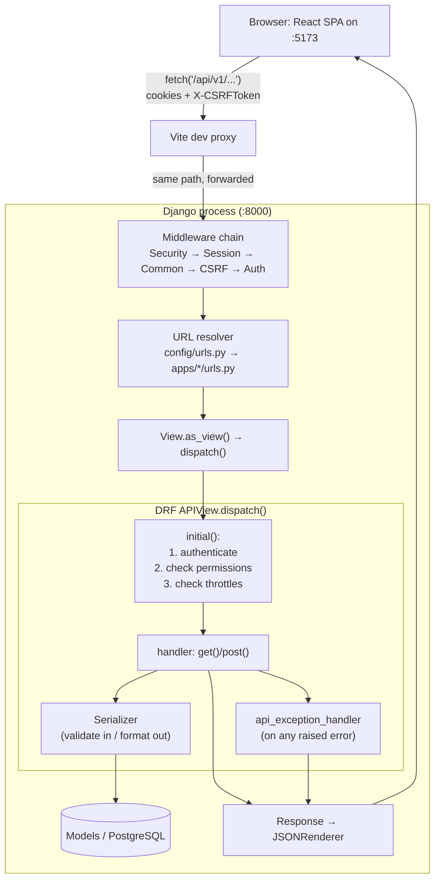
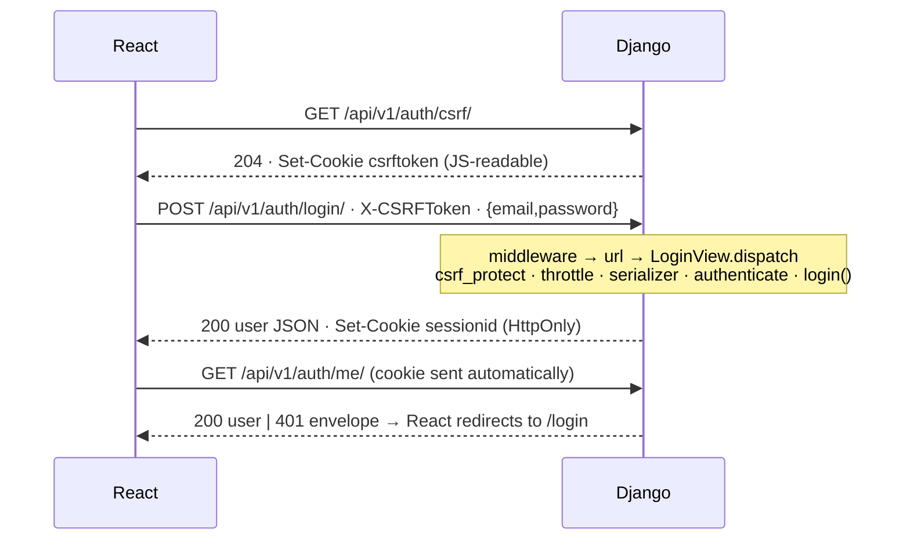

# Flow — how a request moves through this codebase

> **Audience:** a Django developer who is comfortable with function-based views (FBVs)
> and wants to understand the class-based views (CBVs) and Django REST Framework (DRF)
> used here.
>
> **Scope:** what exists today (Phase 1: `core` + `accounts`), traced line by line, plus
> every architectural decision mapped to the file that implements it.
> For the *target* system (billing periods, Celery, Riverty) read
> [architecture.md](architecture.md). This file explains the *mechanics*;
> architecture.md explains the *business design*.

---

## Contents

1. [The mental model in one picture](#1-the-mental-model-in-one-picture)
2. [From FBV to CBV to DRF: the same endpoint four ways](#2-from-fbv-to-cbv-to-drf-the-same-endpoint-four-ways)
3. [What DRF replaces in your FBV habits](#3-what-drf-replaces-in-your-fbv-habits)
4. [Request lifecycle, traced through real code (login)](#4-request-lifecycle-traced-through-real-code-login)
5. [The other endpoints, briefly](#5-the-other-endpoints-briefly)
6. [Where code goes: the layer rules](#6-where-code-goes-the-layer-rules)
7. [Choosing a view class for new endpoints](#7-choosing-a-view-class-for-new-endpoints)
8. [Architectural decision log](#8-architectural-decision-log)
9. [Known limitations and open items](#9-known-limitations-and-open-items)
10. [Glossary and reading order](#10-glossary-and-reading-order)

---

## 1. The mental model in one picture



If you remember one thing: **in an FBV you write every step yourself. In DRF, steps 1-3
(authenticate, permit, throttle) and the error/rendering steps run automatically for
every view, and you configure them with class attributes and settings instead of code.**

---

## 2. From FBV to CBV to DRF: the same endpoint four ways

The endpoint `GET /api/v1/auth/me/` returns the logged-in user as JSON, or 401.
Here it is written at each level of abstraction. Only version D is in the codebase
([apps/accounts/views.py](../backend/apps/accounts/views.py)).

### A. Plain function-based view (what you know)

```python
from django.http import JsonResponse
from django.views.decorators.http import require_GET

@require_GET                                   # method check: by hand
def current_user(request):
    if not request.user.is_authenticated:      # auth check: by hand
        return JsonResponse(
            {"error": {"code": "not_authenticated", "message": "..."}}, status=401
        )
    u = request.user
    return JsonResponse({                      # serialization: by hand
        "id": str(u.id),
        "email": u.email,
        "first_name": u.first_name,
        "last_name": u.last_name,
        "full_name": u.get_full_name() or u.email,
        "is_staff": u.is_staff,
    })
```

Every endpoint repeats the method check, the auth check, the dict-building and the error
format. Forget one and you have a security bug or an inconsistent API.

### B. Django class-based view (plain `django.views.View`)

```python
from django.views import View

class CurrentUserView(View):
    def get(self, request):                    # method routing is now automatic
        if not request.user.is_authenticated:
            return JsonResponse({...}, status=401)
        return JsonResponse({...})
```

What changed: `View.dispatch()` looks at `request.method`, calls `self.get` / `self.post`,
and returns **405 Method Not Allowed** for anything you did not define. That's the whole
point of a CBV: **the framework owns the control flow; you fill in the methods.**

How `as_view()` works (the part that confuses most FBV developers):

```python
path("me/", CurrentUserView.as_view())
# as_view() runs ONCE at import time and returns a plain function, roughly:
def view(request, *args, **kwargs):
    self = CurrentUserView()          # a NEW instance per request (thread-safe)
    self.request = request
    return self.dispatch(request, *args, **kwargs)
# So the URLconf still receives a function. A CBV is a factory for FBVs.
```

### C. DRF `APIView`, everything explicit

```python
from rest_framework.views import APIView
from rest_framework.permissions import IsAuthenticated
from rest_framework.response import Response

class CurrentUserView(APIView):
    authentication_classes = [SessionAuthentication]   # who are you?
    permission_classes = [IsAuthenticated]             # may you do this?

    def get(self, request):
        return Response(CurrentUserSerializer(request.user).data)
```

The auth check disappeared from the method body. `APIView.dispatch()` runs
authentication and permission checks **before** `get()` is ever called. If they fail,
it raises `NotAuthenticated`, which the exception handler turns into a 401 response.

### D. What the codebase actually has

```python
class CurrentUserView(APIView):
    permission_classes = [IsAuthenticated]

    @extend_schema(responses={200: CurrentUserSerializer})
    def get(self, request: Request) -> Response:
        return Response(CurrentUserSerializer(request.user).data)
```

`authentication_classes` is gone too, because it is set **once** for the whole project
in `REST_FRAMEWORK["DEFAULT_AUTHENTICATION_CLASSES"]`
([settings/base.py](../backend/config/settings/base.py)). `permission_classes` is
also a project default (`IsAuthenticated`), so writing it here is redundant. It's kept
on purpose as documentation for the reader. `@extend_schema` only feeds the Swagger
docs at `/api/v1/docs/` and has no runtime effect.

**The progression:** A → D moved four responsibilities out of your function body and into
the framework: method routing, authentication, permission, and error formatting.
What's left in `get()` is the only line that is actually *about this endpoint*.

---

## 3. What DRF replaces in your FBV habits

| You used to write (FBV) | DRF equivalent | Configured in this project at |
|---|---|---|
| `json.loads(request.body)` | `request.data` (parsed by `JSONParser`) | `DEFAULT_PARSER_CLASSES` |
| `JsonResponse(dict)` | `Response(dict)` + a renderer | `DEFAULT_RENDERER_CLASSES` (JSON only; browsable API in local) |
| `@login_required` | `permission_classes = [IsAuthenticated]` | `DEFAULT_PERMISSION_CLASSES` (on for **every** view) |
| `if request.method == "POST"` | define `def post(self, request)` | n/a |
| Django `Form` + `form.is_valid()` | `Serializer` + `serializer.is_valid(raise_exception=True)` | [accounts/serializers.py](../backend/apps/accounts/serializers.py) |
| `ModelForm` | `ModelSerializer` | `CurrentUserSerializer` |
| Building dicts from model instances | `ModelSerializer(instance).data` | `CurrentUserSerializer` |
| `try/except` → `JsonResponse(status=400)` | raise `ValidationError` / `DomainError`; a global handler formats it | [core/exceptions.py](../backend/apps/core/exceptions.py) |
| `Paginator(qs, 25)` by hand | `pagination_class` | [core/pagination.py](../backend/apps/core/pagination.py) |
| Rate limiting (usually nothing) | `throttle_classes` + `throttle_scope` | `DEFAULT_THROTTLE_RATES["login"]` |
| Writing API docs by hand | `drf-spectacular` reads serializers → OpenAPI | `SPECTACULAR_SETTINGS`, `/api/v1/docs/` |

**Serializer = Form for JSON.** It has the same two jobs: validate input
(`is_valid()` → `validated_data`, like `cleaned_data`) and, unlike a Form, convert model
instances to JSON-safe dicts (`.data`).

---

## 4. Request lifecycle, traced through real code (login)

`POST /api/v1/auth/login/` is the most instructive endpoint because it touches every
layer. Follow it step by step.

### Step 0: before login, get a CSRF cookie

React calls `login()` in [frontend/src/api/auth.ts](../frontend/src/api/auth.ts), which
first calls `GET /api/v1/auth/csrf/`. That hits `CsrfCookieView`, decorated with
`ensure_csrf_cookie`. It returns 204 with `Set-Cookie: csrftoken=...`.
The cookie is **not** HttpOnly (`CSRF_COOKIE_HTTPONLY = False`), so JS can read it.

### Step 1: the browser sends the request

[frontend/src/api/client.ts](../frontend/src/api/client.ts) `apiRequest()`:
- reads the `csrftoken` cookie and puts it into the `X-CSRFToken` header (POST is not a
  "safe" method);
- sends `credentials: "same-origin"` so cookies go along;
- body `{"email": "...", "password": "..."}` as JSON.

### Step 2: the Vite proxy

[frontend/vite.config.ts](../frontend/vite.config.ts) forwards `/api/*` from `:5173` to
Django on `:8000`. The browser only ever sees `localhost:5173`, so cookies are
first-party and **no CORS setup exists or is needed**.

### Step 3: Django middleware (in `MIDDLEWARE` order)

| Middleware | What it does for this request |
|---|---|
| `SecurityMiddleware` | Security headers (HSTS/SSL redirect in production). |
| `SessionMiddleware` | Loads `request.session` from the `sessionid` cookie (none yet). |
| `CommonMiddleware` | URL normalisation (trailing slash etc). |
| `CsrfViewMiddleware` | Prepares CSRF checking. DRF views are marked `csrf_exempt` by `APIView.as_view()`, so **DRF re-does CSRF itself** inside `SessionAuthentication`, but only for already-authenticated users (see step 6). |
| `AuthenticationMiddleware` | Sets `request.user` (here: `AnonymousUser`). |

### Step 4: URL resolution

[config/urls.py](../backend/config/urls.py) → `api/v1/` → `auth/` →
[accounts/urls.py](../backend/apps/accounts/urls.py) → `login/` →
`LoginView.as_view()`. The `/api/v1/` prefix is a **versioning** decision. A breaking
change later becomes `/api/v2/` without breaking the existing client.

### Step 5: `as_view()` → `dispatch()`

`APIView.as_view()` creates a fresh `LoginView` instance and calls `dispatch()`.
DRF's `dispatch()` does:

```
dispatch(request)
 ├─ initialize_request()   wraps Django HttpRequest in DRF Request (adds .data, lazy auth)
 ├─ initial()
 │   ├─ perform_authentication()   → SessionAuthentication
 │   ├─ check_permissions()        → AllowAny  (login must be reachable anonymously)
 │   └─ check_throttles()          → ScopedRateThrottle, scope "login" (10/min default)
 ├─ handler = self.post            (chosen from request.method)
 ├─ response = handler(request)
 │     on exception → handle_exception() → api_exception_handler()
 └─ finalize_response()            content negotiation → JSONRenderer
```

### Step 6: the `@csrf_protect` subtlety (the most important security detail)

`SessionAuthentication` only enforces CSRF **when a user is already logged in** via the
session. A login request is anonymous, so DRF would skip the check. Without the
`@method_decorator(csrf_protect, name="dispatch")` on `LoginView`, an attacker's page
could silently log your browser into *the attacker's* account ("login CSRF").

`method_decorator` is how you apply an FBV-style decorator to a CBV: it wraps the method
named `dispatch`, so the decorator runs for every HTTP method of that class.

### Step 7: the handler body (`LoginView.post`)

```python
serializer = LoginSerializer(data=request.data)
serializer.is_valid(raise_exception=True)        # bad shape → ValidationError → 400
user = authenticate(request, username=email, password=password)
if user is None:
    raise AuthenticationFailed("Invalid email or password.")   # → 401
login(request, user)                              # rotates session key; sets sessionid
return Response(CurrentUserSerializer(user).data)
```

Points that FBV code commonly gets wrong, done right here:

- **The serializer validates shape only**: is it an email, is the password present?
  Whether the password is *correct* is checked by `authenticate()`. Shape validation
  and business checks are kept apart.
- **`authenticate(username=...)`**: the keyword is `username` even though we log in by
  email, because Django passes it to `USERNAME_FIELD`, which is `"email"` on our `User`.
  `UserManager.get_by_natural_key` uses `email__iexact`, so login is case-insensitive.
- **Same error for "no such user" and "wrong password"**, so the response does not
  reveal which emails exist.
- **`login()` rotates the session key**, which prevents session fixation.
- **Errors are raised, not returned.** The view never builds an error response itself.

### Step 8: errors become one envelope

Any exception raised in step 5-7 goes to `api_exception_handler`
([core/exceptions.py](../backend/apps/core/exceptions.py)):

| Raised | HTTP | Body |
|---|---|---|
| `serializers.ValidationError` | 400 | `{"error": {"code": "validation_error", "message": "Invalid input.", "details": {field: [msgs]}}}` |
| `NotAuthenticated` / `AuthenticationFailed` | **401** (DRF default would be 403) | `{"error": {"code": "not_authenticated" \| "authentication_failed", ...}}` |
| `Throttled` | 429 | `{"error": {"code": "throttled", ...}}` |
| `DomainError` (future service layer) | 422 | `{"error": {"code": <subclass code>, ...}}` |
| anything else | 500 | Django default; **no internal text leaked** |

### Step 9: back in the browser

`apiRequest()` parses the envelope into an `ApiError(status, code, message, details)`.
`useLogin()` ([features/auth/hooks.ts](../frontend/src/features/auth/hooks.ts)) puts the
returned user into the TanStack Query cache under `["auth","me"]`, so `ProtectedRoute`
sees a user and renders the app. The `sessionid` cookie is HttpOnly. JS never sees it,
and the browser simply attaches it to every later request.



---

## 5. The other endpoints, briefly

| Endpoint | View | Notable class attributes and why |
|---|---|---|
| `GET /api/v1/health/` | `HealthCheckView` ([core/views.py](../backend/apps/core/views.py)) | `authentication_classes = []`: a load balancer calls it, so there's no session lookup and no CSRF. `AllowAny`. Returns **503** when the DB is down so infrastructure can act on the status code alone. Checks live in [core/health.py](../backend/apps/core/health.py) as plain functions (testable, extensible). |
| `GET /api/v1/auth/csrf/` | `CsrfCookieView` | `ensure_csrf_cookie`; `AllowAny`. |
| `POST /api/v1/auth/logout/` | `LogoutView` | `IsAuthenticated`. `logout()` deletes the **server-side** session row, so it's real revocation, not just clearing a cookie. |
| `GET /api/v1/auth/me/` | `CurrentUserView` | See §2. React uses it on page load to answer "am I logged in?". |
| `GET /api/v1/schema/`, `/docs/` | drf-spectacular | OpenAPI generated from serializers + `@extend_schema`. |
| `/admin/` | Django admin | `UserAdmin` adapted for email login ([accounts/admin.py](../backend/apps/accounts/admin.py)). |

---

## 6. Where code goes: the layer rules

Today the views talk to models directly, because login/logout/me are thin wrappers
around Django's auth functions. From Phase 2 onward the rule from
[architecture.md §A.2](architecture.md) applies:

```
views.py / serializers.py   HTTP only: parse, validate shape, call ONE service or selector, render
        │
        ▼
services.py                 writes: one function per use case, owns transaction.atomic(),
selectors.py                reads: querysets with select_related/annotations
        │
        ▼
models.py                   fields, DB constraints, small invariants
```

Dependencies point **downwards only**. A service never imports `Request`; a model
never calls an external API. This is why a Celery task and a dashboard button can later
call the *same* `submit_invoice()` service and get identical behaviour.

**FBV analogy:** in many FBV projects the view function *is* the business logic: it
validates, queries, saves, sends email, all in one body. Here the view becomes the
equivalent of a 5-line FBV that calls a plain Python function. The class machinery
handles HTTP; the service handles the business.

Illustration of what a Phase 2 endpoint will look like (not in the codebase yet):

```python
# apps/customers/views.py   (presentation)
class CustomerListCreateView(generics.ListCreateAPIView):
    serializer_class = CustomerSerializer

    def get_queryset(self):
        return selectors.list_customers(search=self.request.query_params.get("search"))

    def perform_create(self, serializer):
        # The service, not the serializer, decides how a customer is created.
        serializer.instance = services.create_customer(
            data=serializer.validated_data, actor=self.request.user
        )

# apps/customers/services.py   (application)
def create_customer(*, data: dict, actor: User) -> Customer:
    with transaction.atomic():
        customer = Customer.objects.create(**data)
        AuditLog.record(actor=actor, action="customer.created", entity=customer)
    return customer
```

---

## 7. Choosing a view class for new endpoints

DRF gives you a ladder. Climb only as high as the endpoint needs.

| Class | You get | Use it when | Example here |
|---|---|---|---|
| `APIView` | auth, permissions, throttling, Request/Response, error handling | The endpoint is an **action**, not CRUD on one model | login, logout, me, health; later `POST /agreements/{id}/pause/` |
| `generics.*APIView` (`ListCreateAPIView`, `RetrieveUpdateAPIView`, ...) | + `get_queryset`, `get_object`, pagination, `perform_create/update` hooks | Standard list/detail on a model, with a hook to call a service | customers list/create (Phase 2) |
| `ViewSet` / `ModelViewSet` + `Router` | + several endpoints in one class, URLs generated, `@action` for extra routes | A full resource with many operations | agreements: CRUD + `@action pause/resume/cancel` |

Guidelines:

- **Don't use `ModelViewSet` just because it's short.** It exposes `DELETE` and `PUT` by
  default. For financial records, deleting must be impossible: declare only the mixins
  you need (`mixins.ListModelMixin`, `mixins.RetrieveModelMixin`, ...).
- **State transitions are actions, not field edits.** `PATCH {"status": "PAUSED"}` lets a
  client skip business rules. `POST /agreements/{id}/pause/` calls
  `services.pause_agreement()`, which checks the allowed-from states and raises
  `DomainError` (→ 422) otherwise.
- **Override hooks, not `post()`/`get()`,** on generic views: `get_queryset`,
  `get_serializer_class`, `perform_create`. Overriding the handler throws away the
  machinery you chose the class for.
- **Separate read and write serializers** when shapes differ (e.g. `AgreementSerializer`
  for output with nested customer, `AgreementCreateSerializer` for input with
  `customer_id`).

---

## 8. Architectural decision log

Each row: the decision, where it lives, why, and what was rejected.
"FBV habit" shows what an FBV project typically does instead.

### 8.1 Project shape and configuration

| # | Decision | Where | Why | Rejected alternative |
|---|---|---|---|---|
| D1 | **Modular monolith**: one Django deployable, apps with boundaries | `backend/apps/*` | Exactly-once invoicing is easiest when period + submission + outbox commit in **one DB transaction**. 100-300 invoices/month is no reason for network hops. | Microservices (distributed transactions, more failure modes). |
| D2 | **Apps under `apps/`, created only in the phase that needs them** | `apps/core`, `apps/accounts` | Empty apps add migrations and noise. | Scaffolding every app up front. |
| D3 | **`core` app for shared building blocks** | [apps/core](../backend/apps/core) | Base models, error envelope, pagination and health aren't a business domain; they need a neutral home. | Copy-pasting into each app; a vague `utils` app. |
| D4 | **Settings split: `base` / `local` / `test` / `production`** | [config/settings/](../backend/config/settings) | Each environment overrides only what differs; production hardening can't leak into dev or the reverse. `manage.py` and `wsgi.py` default to `local`; pytest uses `test`. | One `settings.py` with `if DEBUG:` branches. |
| D5 | **Config from environment variables via tiny typed helpers** | [config/env.py](../backend/config/env.py) | 12-factor. Required vars (`DJANGO_SECRET_KEY`, `POSTGRES_*`) fail **at startup** with a clear message instead of at first use. Types are visible in `base.py`. | `django-environ` (an extra dependency for ~40 lines); hard-coded secrets. |
| D6 | **`.env` loaded with `override=False`** | `settings/base.py` | Real env vars (Docker, prod) always win over a stray file. | `override=True` (a forgotten `.env` silently shadows prod config). |
| D7 | **Pinned dependencies, split `base.txt` / `dev.txt`** | [requirements/](../backend/requirements) | Reproducible builds; test/lint tools don't ship to production. | Unpinned `Django>=5`. |

### 8.2 Database

| # | Decision | Where | Why | Rejected alternative |
|---|---|---|---|---|
| D8 | **PostgreSQL everywhere, no SQLite fallback, even in tests** | `DATABASES`, [settings/test.py](../backend/config/settings/test.py) | Later phases depend on `SELECT … FOR UPDATE SKIP LOCKED`, functional/partial unique indexes and case-sensitivity rules that SQLite doesn't have. Tests on SQLite would pass while prod fails. | SQLite for speed. |
| D9 | **`ATOMIC_REQUESTS = False`** | `DATABASES` | Transactions are opened deliberately and kept **short** in services. A request-wide transaction would hold locks during slow work (and later during HTTP calls to Riverty). | Wrapping every request in a transaction. FBV habit: `@transaction.atomic` on the whole view. |
| D10 | **`CONN_MAX_AGE=60` + `CONN_HEALTH_CHECKS`** | `DATABASES` | Reuses connections instead of reconnecting per request; health checks drop dead ones. | Default 0 (new connection every request). |
| D11 | **UUID primary keys** | `UUIDModel` in [core/models.py](../backend/apps/core/models.py), `User.id` | IDs appear in URLs; sequential ints leak volume and invite `id+1` enumeration. UUIDs can be generated before save (useful for outbox payloads). | Auto-increment integers. |
| D12 | **Abstract `UUIDModel` / `TimeStampedModel`** | `core/models.py` | Every domain model gets `id`, `created_at`, `updated_at` consistently, and abstract means no extra table or join. | Multi-table inheritance (creates joins); repeating fields. |
| D13 | **Constraints in the database, not only in Python** | `UniqueConstraint(Lower("email"))` on `User` | Python validation gives good messages; DB constraints give **guarantees** against races, `bulk_create`, raw SQL and admin edits. | `clean()`-only validation. |

### 8.3 Users and authentication

| # | Decision | Where | Why | Rejected alternative |
|---|---|---|---|---|
| D14 | **Custom `User` model from day one** | [accounts/models.py](../backend/apps/accounts/models.py), `AUTH_USER_MODEL` | Swapping `AUTH_USER_MODEL` after migrations and FKs exist is painful. Starting custom costs nothing. | Default `auth.User`. |
| D15 | **Email login, no username** | `USERNAME_FIELD = "email"`, `username = None` | Staff identify by email; one less field to keep in sync. | Username + email. |
| D16 | **Custom `UserManager`, emails fully lower-cased** | [accounts/managers.py](../backend/apps/accounts/managers.py) | Django's `normalize_email` lower-cases only the domain. `get_by_natural_key` uses `iexact`, so login is case-insensitive. | Relying on the built-in normalisation. |
| D17 | **Session cookie auth + CSRF, not JWT** | `DEFAULT_AUTHENTICATION_CLASSES`, cookie settings | Same-site internal dashboard: HttpOnly cookie can't be stolen by XSS; logout is immediate server-side revocation. Full comparison in [architecture.md Part C](architecture.md). | JWT in `localStorage`. |
| D18 | **`SESSION_COOKIE_HTTPONLY=True`, `CSRF_COOKIE_HTTPONLY=False`, both `SameSite=Lax`; 8-hour session** | `settings/base.py` | Session id is invisible to JS; CSRF token must be readable so React can echo it as a header. One workday per session. | n/a |
| D19 | **`csrf_protect` on `LoginView`** | `accounts/views.py` | DRF skips CSRF for anonymous requests, which would allow login CSRF. | Trusting DRF's default. |
| D20 | **Login throttle (`ScopedRateThrottle`, scope `login`, 10/min)** | `LoginView`, `DEFAULT_THROTTLE_RATES` | Slows password guessing. Rate comes from env. | No rate limit. |
| D21 | **Generic login error message; logs never contain the email/password** | `LoginView.post` | No user enumeration; no credentials in logs. | "No user with that email". |
| D22 | **Strong password validators (min length 12)** | `AUTH_PASSWORD_VALIDATORS` | Finance tool; length is the most effective rule. | Django default (8). |

### 8.4 API design (DRF)

| # | Decision | Where | Why | Rejected alternative |
|---|---|---|---|---|
| D23 | **Secure by default: `IsAuthenticated` globally**; public views opt out explicitly with `AllowAny` | `DEFAULT_PERMISSION_CLASSES` | A forgotten decorator can't expose an endpoint. FBV habit: remembering `@login_required` on every view. | Opt-in protection. |
| D24 | **Class-based `APIView` for auth/health, not generics/ViewSets** | `accounts/views.py`, `core/views.py` | They're actions, not CRUD on a model (see §7). | `ModelViewSet` on `User`. |
| D25 | **Serializers validate shape; views/services decide behaviour** | `LoginSerializer` | Keeps the serializer reusable and the security logic visible in one place. | Calling `authenticate()` inside `validate()`. |
| D26 | **Versioned URL prefix `/api/v1/`** | [config/urls.py](../backend/config/urls.py) | Breaking changes go to v2 without breaking the deployed SPA. | Unversioned `/api/`. |
| D27 | **Every app owns its `urls.py`; the project URLconf only `include()`s** | `apps/*/urls.py` | Keeps app boundaries; an app can be moved or removed in one line. | One giant URL list. |
| D28 | **One error envelope `{"error": {code, message, details}}`** | `api_exception_handler` | One parser on the frontend; machine-readable `code` for branching, `details` mapped to form fields. | DRF's mixed default shapes (`{"detail": ...}` vs `{"field": [...]}`). |
| D29 | **401 for "not logged in", 403 for "not allowed"** | `api_exception_handler` | DRF returns 403 for session auth by default; the SPA relies on 401 to redirect to login. | Accepting DRF's 403. |
| D30 | **`DomainError` → 422, raised by services** | `core/exceptions.py` | Business-rule violations stay free of HTTP concepts but still reach the client with a precise code. | Services returning `Response` objects; using 400 for everything. |
| D31 | **Unhandled errors → plain 500, never leaking internals** | `api_exception_handler` returns `None` | Tracebacks go to logs, not to the client. | `str(exc)` in the response body. |
| D32 | **Page-number pagination, page size 25, client-selectable, capped at 100** | [core/pagination.py](../backend/apps/core/pagination.py) | Same shape for every list (`count, page, page_size, total_pages, next, previous, results`); cap stops "give me a million rows". Page lives in the URL, so views can be bookmarked. | Cursor pagination (no "page 5 of 9" for a dashboard); unbounded lists. |
| D33 | **JSON-only parser/renderer; browsable API only in `local`** | `REST_FRAMEWORK`, [settings/local.py](../backend/config/settings/local.py) | Smaller attack surface in production; convenient in dev. | Form/multipart parsers everywhere. |
| D34 | **OpenAPI via drf-spectacular** | `/api/v1/schema/`, `/api/v1/docs/` | Docs generated from the code can't drift from it. | Hand-written docs. |

### 8.5 Operations and quality

| # | Decision | Where | Why | Rejected alternative |
|---|---|---|---|---|
| D35 | **Health endpoint: public, no auth classes, 200/503, reveals only ok/unavailable** | `HealthCheckView`, `core/health.py` | Load balancers and Docker act on status codes; no hostnames or error text leaked. | Authenticated health; always-200 "ping". |
| D36 | **Logging to stdout, one line per event** | `LOGGING` | The container platform collects it. JSON logs + request IDs planned for Phase 10. | Log files inside the container. |
| D37 | **Times stored in UTC; separate `BILLING_TIME_ZONE`** | `TIME_ZONE`, `USE_TZ`, `BILLING_TIME_ZONE` | Timestamps are instants (UTC); "which day is a billing date" is a business-calendar question (Phase 4). | Server-local time. |
| D38 | **Tests live inside each app, run with pytest against real Postgres** | `apps/*/tests/`, [conftest.py](../backend/conftest.py), [pyproject.toml](../backend/pyproject.toml) | Tests move with the code they protect. `csrf_client` fixture enforces CSRF like a real browser, since the default test client skips it. | Top-level `tests/`; SQLite. |
| D39 | **MD5 hasher + high throttle rate in test settings only** | `settings/test.py` | Fast tests; throttling can't cause flaky failures (the throttle test overrides it). | Slow PBKDF2 in tests. |
| D40 | **Ruff for lint + format, incl. `DJ` (Django) rules** | `pyproject.toml` | One fast tool replaces flake8 + isort + black. | Multiple linters. |
| D41 | **Docker Compose for an optional full stack; Postgres on host port 5433** | [docker-compose.yml](../docker-compose.yml) | Works alongside a local Postgres on 5432. `depends_on: service_healthy` waits for the DB. | Requiring Docker for everyone. |

### 8.6 Frontend contract (summary; details in [architecture.md A.7 / Part C](architecture.md))

| # | Decision | Where | Why |
|---|---|---|---|
| D42 | **Single HTTP client** (`apiRequest`) handles CSRF header, cookies, error envelope | [frontend/src/api/client.ts](../frontend/src/api/client.ts) | Implemented once; features never call `fetch` directly. |
| D43 | **Vite proxy → one origin, no CORS** | [frontend/vite.config.ts](../frontend/vite.config.ts) | First-party cookies in dev; prod serves SPA + `/api` from one domain. |
| D44 | **Server state only in TanStack Query; cache cleared on logout; 401 globally → logged out** | [frontend/src/api/queryClient.ts](../frontend/src/api/queryClient.ts) | No stale copies in `useState`; one user never sees another's data. |
| D45 | **Reads retried on network/5xx; writes never auto-retried** | `queryClient.ts` | Retrying a non-idempotent POST could duplicate it. |
| D46 | **`ProtectedRoute` is UX, not security** | [frontend/src/routes/ProtectedRoute.tsx](../frontend/src/routes/ProtectedRoute.tsx) | Real protection is D23 on the server. |

---

## 9. Known limitations and open items

Found while writing this document. None block Phase 1, but each should be resolved
before production.

1. ~~**Throttle counters are per-process.**~~ **Resolved in Phase 7:** `CACHES` now points
   at Redis, so every web process shares one login-attempt counter. (Before, each process
   kept its own in-memory count, so 4 processes allowed ~4× the limit.)
2. ~~**Throttling is by client IP.**~~ **Resolved in Phase 10:** production sets
   `REST_FRAMEWORK["NUM_PROXIES"]` from `DJANGO_NUM_PROXIES`, so the real client IP is
   read from `X-Forwarded-For` (see [deployment.md](deployment.md)).
3. **`DEFAULT_AUTO_FIELD = BigAutoField` vs UUID keys.** Harmless (it only applies to
   models that don't declare a PK), but new domain models must inherit `UUIDModel` /
   `TimeStampedModel` to follow D11. Worth a review checklist item.
4. ~~**Production settings are a stub.**~~ **Resolved in Phase 10:** gunicorn, non-root
   image, collected static files, JSON logs with request ids, required production
   configuration. See [deployment.md](deployment.md).
5. ~~**No `services.py` / `selectors.py` yet.**~~ **Resolved from Phase 2 on:** every
   domain app now follows the layering in §6.

---

## 10. Glossary and reading order

| Term | Meaning |
|---|---|
| `as_view()` | Class method that turns a CBV into the function the URLconf needs. New instance per request. |
| `dispatch()` | CBV method that routes to `get`/`post`/...; in DRF also runs auth, permissions, throttles and exception handling. |
| `method_decorator` | Adapter to apply a function decorator (`csrf_protect`) to a CBV method. |
| Serializer | DRF's Form for JSON: validates input (`validated_data`), formats output (`.data`). |
| Authentication class | Answers *who are you?* and sets `request.user`. |
| Permission class | Answers *may you do this?* Runs after authentication. |
| Throttle class | Answers *are you doing this too often?* |
| Exception handler | One function that turns any raised API exception into a response. |
| Service / selector | Plain functions for writes / reads; the business layer between views and models. |
| `DomainError` | Exception for business-rule violations; becomes HTTP 422. |

**Suggested reading order of the code** (≈30 minutes):

1. [config/settings/base.py](../backend/config/settings/base.py): read `REST_FRAMEWORK` first; it sets the defaults every view inherits.
2. [config/urls.py](../backend/config/urls.py) → [apps/accounts/urls.py](../backend/apps/accounts/urls.py)
3. [apps/accounts/views.py](../backend/apps/accounts/views.py) with §4 of this file open
4. [apps/accounts/serializers.py](../backend/apps/accounts/serializers.py)
5. [apps/core/exceptions.py](../backend/apps/core/exceptions.py)
6. [apps/accounts/tests/test_auth_api.py](../backend/apps/accounts/tests/test_auth_api.py): the tests read like a specification of the flow
7. [apps/accounts/models.py](../backend/apps/accounts/models.py) + [managers.py](../backend/apps/accounts/managers.py)

Recommended external reading: the DRF tutorial parts 3 ("Class-based views") and 6
("ViewSets & Routers"), and [ccbv.co.uk](https://ccbv.co.uk) / [cdrf.co](https://www.cdrf.co),
which show every method each Django/DRF class inherits, so you can see exactly what
`dispatch()` calls.
